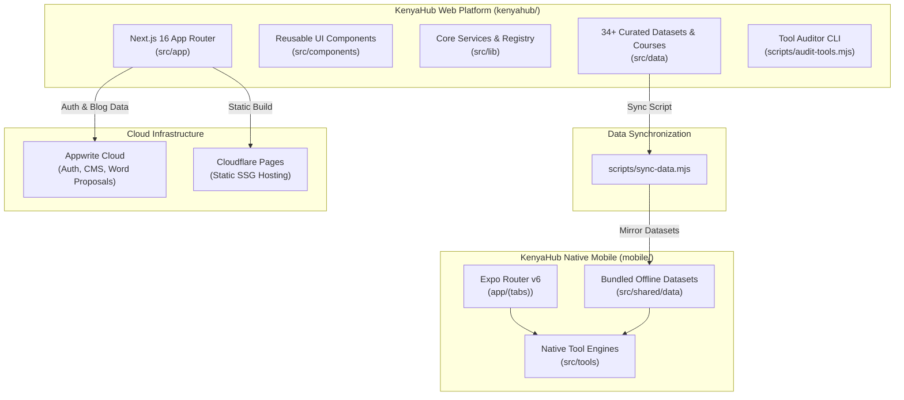
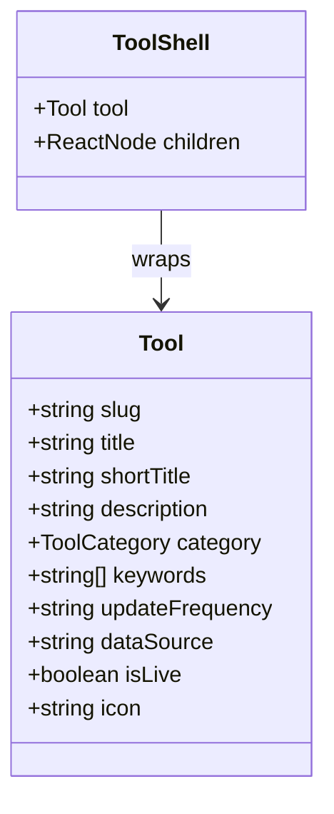
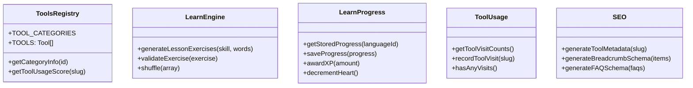
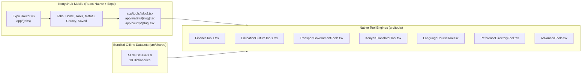

# KenyaHub Platform Architecture & File-by-File Analysis

> **Platform Overview**  
> **KenyaHub** is a Kenya-first, SEO-native web platform and offline-capable Android application engineered to consolidate vital Kenyan public data, calculators, statutory schedules, and educational tools into fast, accessible interfaces. Built with a modern static-first architecture (**Next.js 16 App Router**, **React 19**, **Tailwind CSS v4**, **Appwrite**, and **Expo/React Native**), every tool operates with dedicated static URLs, instant client-side execution, and zero unnecessary server roundtrips.

---

## 1. Root Configuration & Project Scaffold

### `kenyahub/package.json`
- **Purpose**: Defines dependencies, build pipelines, and project scripts.
- **Key Modules**:
  - `next`: ^16.3.8 (App Router, static export mode).
  - `react` & `react-dom`: 19.2.4.
  - `@tailwindcss/postcss` & `tailwindcss`: ^4 (utility-first styling).
  - `appwrite` (^16.1.0) & `node-appwrite` (^26.2.0): Client and server SDKs for Appwrite Cloud.
  - `leaflet` (^1.9.4) & `@types/leaflet`: OpenStreetMap-based routing and county map visualization.
  - `fuse.js` (^7.4.2): High-performance client-side fuzzy search for dictionaries, routes, and tools.
  - `lucide-react` (^1.21.0): Lightweight icon library.
- **Execution Scripts**:
  - `npm run dev`: Starts local Next.js development server.
  - `npm run build`: Compiles production static assets into `out/`.
  - `npm run audit:tools`: Executes the data auditor script to verify datasets and routes.
  - `npm run audit:tools:sources`: Verifies remote regulatory sources and URL freshness.
  - `npm run deploy`: Builds static bundle and pushes to Cloudflare Pages via Wrangler.

### `kenyahub/next.config.ts`
- **Purpose**: Next.js framework configuration.
- **Key Settings**:
  - `output: "export"`: Compiles the application into an entirely static HTML/CSS/JS export (SSG), eliminating runtime Node.js server overhead and enabling hosting on Cloudflare Pages or any static CDN.
  - `images: { unoptimized: true }`: Ensures image optimization does not depend on dynamic Node.js image servers in static mode.
  - `trailingSlash: true`: Generates folder-based `index.html` files (e.g. `/tools/paye-calculator/index.html`) for clean URLs and SEO indexing.

### `kenyahub/tsconfig.json` & `postcss.config.mjs`
- **Purpose**: TypeScript compiler options and Tailwind CSS PostCSS pipeline configuration.
- Configures path alias `@/*` pointing to `kenyahub/src/*` for clean modular imports.

### `appwrite.config.json`
- **Purpose**: Infrastructure-as-code schema for Appwrite backend services.
- Defines database ID, collections (blog posts, translation proposals, user contributions), indexes, and role-based permissions.

---

## 2. Next.js App Router Hierarchy (`src/app/`)

### Root Application Files
- `src/app/layout.tsx`: The global root layout component. Injects Google Fonts (**Inter** for UI, **Outfit** for headers), mounts the global theme provider, renders the persistent `<Navbar />` and `<Footer />`, and attaches `<CookieConsent />`. Implements base SEO metadata and OpenGraph templates.
- `src/app/page.tsx`: The KenyaHub homepage. Features a hero section inspired by the Kenyan flag's colorway, interactive search with auto-suggest, `<PinnedToolsHomeSection />` (localStorage pinned favorites), `<PopularToolsSection />` (usage-ranked tools), and category-driven directory grids. Embeds JSON-LD `WebSite` and `Organization` schemas.
- `src/app/globals.css`: Tailwind CSS v4 styling rules, custom CSS variables for Kenya-inspired themes (Kenya Red, Kenya Green, Gold accents, dark mode palettes), and animations (pulse, float).
- `src/app/icon.svg`: Vector favicon displaying the KenyaHub emblem.
- `src/app/robots.ts`: Generates dynamic `robots.txt` crawler rules for Googlebot, Bingbot, and other search engines.
- `src/app/sitemap.ts`: Generates the XML sitemap covering all static pages, tool routes, matatu routes, and county directory slugs.

---

### Informational & Legal Pages
- `src/app/about/page.tsx`: Describes KenyaHub's mission—democratizing access to public Kenyan data and free calculation tools without paywalls or intrusive trackers.
- `src/app/contact/page.tsx`: Contact information, feedback form, and issue reporting pathways.
- `src/app/privacy/page.tsx`: Comprehensive privacy disclosure detailing privacy-first analytics, absence of personally identifiable tracking, and localStorage usage.
- `src/app/terms/page.tsx`: Terms of service, statutory disclaimers, and open data attribution policies.

---

### County Directory (`src/app/county/`)
- `src/app/county/layout.tsx`: Common layout wrapper for county profiles.
- `src/app/county/page.tsx`: Interactive explorer of all 47 Kenyan counties (Code 001 Mombasa to 047 Nairobi). Provides instant filtering by region, capital town, population, and land area.
- `src/app/county/[slug]/layout.tsx`: Generates dynamic SEO metadata, titles, and breadcrumbs per county.
- `src/app/county/[slug]/page.tsx`: Detailed county fact-sheet featuring county code, governor/leadership data, sub-counties, major economic drivers, tourist sites, and budget allocations sourced from the Controller of Budget.

---

### Matatu Transit Portal (`src/app/matatu/`)
- `src/app/matatu/layout.tsx`: Transit section wrapper with quick town navigation.
- `src/app/matatu/page.tsx`: Matatu transit home. Allows commuters to search by town (Nairobi, Mombasa, Kisumu, Nakuru, Eldoret) or route number.
- `src/app/matatu/[town]/page.tsx`: Lists all registered SACCO routes, origin terminuses, destinations, intermediate stages, and estimated fare bands for a specific town.
- `src/app/matatu/[town]/[route]/page.tsx`: Deep-dive view of a single matatu route. Renders the interactive `<MatatuMap />`, list of pickup/drop-off points, active SACCO operators, and commuter travel tips.

---

### Blog & Editorial Content (`src/app/blog/`)
- `src/app/blog/layout.tsx`: Editorial layout containing categories, tags, and newsletter CTA.
- `src/app/blog/page.tsx`: Index of practical guides and articles on Kenyan personal finance, CBC updates, tax laws, and technology.
- `src/app/blog/[slug]/layout.tsx`: Injects `Article` schema, OpenGraph tags, author metadata, and reading time.
- `src/app/blog/[slug]/page.tsx`: Server component resolving the blog post slug and rendering `<BlogPostContent />`.
- `src/app/blog/[slug]/BlogPostContent.tsx`: Client component that parses Markdown content, generates an interactive Table of Contents, and formats callout cards.

---

### Admin Dashboard & CMS (`src/app/admin/`)
- `src/app/admin/layout.tsx`: Admin-only navigation bar, authentication guard, and sidebar.
- `src/app/admin/page.tsx`: Central administrative dashboard showing platform stats, review queues, and quick actions.
- `src/app/admin/login/page.tsx`: Appwrite email/password authentication screen for site administrators.
- `src/app/admin/posts/layout.tsx` & `src/app/admin/posts/page.tsx`: Article management table for drafting, editing, and publishing blog posts.
- `src/app/admin/posts/new/page.tsx`: Rich Markdown editor for composing new articles with live preview.
- `src/app/admin/posts/edit/page.tsx`: Interface for modifying existing blog posts.
- `src/app/admin/settings/page.tsx`: Admin system settings and environment configuration.
- `src/app/admin/translations/page.tsx`: Moderation console for approving, editing, or rejecting user-submitted dictionary words and phrase contributions.

---

## 3. Dedicated Tool Suites (`src/app/tools/`)

KenyaHub provides 44+ specialized web tools. Each folder contains a dedicated `page.tsx` rendering a high-speed interactive application.

### Finance & Tax Tools
1. `paye-calculator/page.tsx`: **PAYE Salary Calculator 2026**. Calculates net take-home salary from gross income. Incorporates official KRA tax bands (24%, 30%, 32.5%, 35%), Personal Relief (KSh 2,400/month), Insurance Relief, tiered NSSF contributions (Tier I & Tier II), new Social Health Authority (SHA) 2.75% rate, and Affordable Housing Levy (1.5%). Provides an itemized deduction breakdown and salary comparison.
2. `mpesa-fee-calculator/page.tsx`: **M-Pesa Transaction Fee Calculator**. Evaluates Safaricom transaction tariffs across Send to Registered, Send to Unregistered, Cash Withdrawal (Agent & ATM), Lipa na M-Pesa (Buy Goods & Paybill). Includes an intelligent "split savings analyzer" showing how breaking large amounts into smaller brackets saves tariff fees.
3. `housing-levy-calculator/page.tsx`: **Affordable Housing Levy Calculator**. Calculates the statutory 1.5% employee deduction and matching 1.5% employer contribution mandated by the Affordable Housing Act.
4. `stamp-duty-calculator/page.tsx`: **Stamp Duty Calculator**. Computes land and property transaction duties (4% in municipalities/cities, 2% in rural areas, plus mortgage and lease rates).
5. `vehicle-insurance-calculator/page.tsx`: **Vehicle Insurance Estimator**. Estimates comprehensive, third-party only (TPO), and third-party fire and theft premiums based on car value, vehicle class (private, commercial, PSV), and statutory levies (PCF and Training Levy).
6. `helb-calculator/page.tsx`: **HELB Loan Repayment Calculator**. Calculates monthly student loan amortization schedules, 4% interest accrual, monthly KSh 500 late-payment penalties, and payoff projections.

### Utilities & Energy Tools
7. `kplc-token-calculator/page.tsx`: **KPLC Electricity Token Calculator**. Dissects prepaid token purchases and postpaid bills. Calculates lifeline vs. domestic ordinary tariff bands, Fuel Energy Cost charge, Forex Adjustment, EPRA Levy, WRA Levy, REP Levy, and 16% VAT. Displays exact units (kWh) received for any shilling amount.
8. `water-bill-calculator/page.tsx`: **Water Bill Calculator**. Calculates graduated consumption tariffs across major Kenyan water service providers (NCWSC Nairobi, MOWASCO Mombasa, KIWASCO Kisumu) including meter rent and sewer levies.
9. `solar-roi-calculator/page.tsx`: **Solar PV System Sizing & ROI Calculator**. Uses Kenyan regional solar irradiance data to calculate necessary solar panel wattages, battery storage, cost savings, and payback period against KPLC grid rates.

### Education & CBC Tools
10. `cbc-curriculum/page.tsx`: **CBC Curriculum Explorer (PP1 - Grade 12)**. Complete interactive navigator of Kenya's Competency-Based Curriculum. Displays core learning areas, optional subjects, strands, and sub-strands across Pre-Primary, Primary, Junior School, and Senior School pathways.
11. `cbc-grade-age/page.tsx`: **CBC Grade & Age Checker**. Accepts a child's birth date and calculates their current and upcoming CBC grade, traditional 8-4-4 class equivalent, expected learning milestones, and national assessment years (KPSEA, KJSEA, KSSEA).
12. `kuccps-cluster-calculator/page.tsx`: **KUCCPS Cluster Points Calculator**. Calculates weighted cluster points ($C = \sqrt{\frac{r}{m} \cdot \frac{R}{M}} \cdot 48$) from KCSE subject grades. Compares candidate scores against historical degree cutoff points across all public and private Kenyan universities.
13. `kcse-grade-calculator/page.tsx`: **KCSE Mean Grade Calculator**. Converts letter grades (A through E) to numerical points (1 to 12) across 7 or 8 subjects, determines mean grade, and identifies qualification for degree, diploma, craft certificate, and artisan courses.
14. `kcse-school-rankings/page.tsx`: **KCSE School Rankings & Historical Performance**. Filterable database of national, extra-county, and county secondary schools in Kenya with historical mean scores and university transition rates.
15. `school-terms/page.tsx`: **Ministry of Education School Calendar**. Visual calendar detailing Term 1, Term 2, and Term 3 opening dates, closing dates, half-term breaks, and national examination periods for primary and secondary schools.

### Government & Legal Tools
16. `public-holidays/page.tsx`: **Kenya Public Holidays Calendar**. Complete gazetted calendar under Cap 110 (Madaraka Day, Mashujaa Day, Jamhuri Day, Idd, Easter, etc.) featuring live countdown clocks, historical explanations, and a one-click `.ics` calendar export.
17. `traffic-fines/page.tsx`: **NTSA Traffic Fines & Penalties Guide**. Searchable database of minor and major traffic offenses under the Traffic Act (Cap 403), displaying instant fines, court attendance requirements, and demit point warnings.
18. `driving-license-guide/page.tsx`: **NTSA Smart Driving License Guide**. Step-by-step checklist for acquiring and renewing the Smart DL on the E-Citizen / TIMS portal, medical requirements, driving test booking, and Category A, B, C, D endorsements.
19. `number-plate-decoder/page.tsx`: **Kenyan Number Plate Decoder**. Decodes any vehicle registration plate (e.g. `KDA 123A`), displaying estimated year of registration, series progression, and special codes for Diplomatic (CD), Government (GK), County (CG), and Military (KDF) vehicles.
20. `passport-id-fees/page.tsx`: **Immigration Passport & National ID Fees Guide**. Displays the official revised Directorate of Immigration fees for ordinary passports (34, 50, 66 pages), lost passport replacement, diplomatic passports, first-time National ID application (Maisha Card), and replacement cards.
21. `trademark-cost-kenya/page.tsx`: **KIPI Trademark Cost Calculator**. Computes official Kenya Industrial Property Institute fees for name search (TM27), preliminary advice, application (TM2), gazette advertisement, and registration.
22. `professional-bodies-kenya/page.tsx`: **Professional Registration & Licensing Directory**. Directory of Kenya's statutory professional bodies (LSK, ICPAK, EBK, KMPDC, IEK, BORAQS), outlining registration prerequisites, annual CPD requirements, and practicing certificate renewal fees.
23. `kenya-customs-restricted-items/page.tsx`: **KRA Customs Baggage & Restricted Items Guide**. Comprehensive guide to passenger duty-free allowances at JKIA and border points, dutiable personal electronics, restricted items requiring permits (drones, agricultural produce), and prohibited goods under the EAC Customs Management Act.

### Transport & Travel Tools
24. `matatu-routes/page.tsx`: **Kenyan Matatu Routes & Stages Explorer**. Searchable catalog of urban matatu routes (Nairobi Route 23 to Kangemi, Route 46 to Kawangware, Route 111 to Ngong, Route 125 to Rongai, Mombasa Bamburi shuttles, etc.) with fare ranges, stage locations, and operating SACCOs.

### Health & Wellness Tools
25. `nhif-hospital-finder/page.tsx`: **SHA / NHIF Accredited Hospital Finder**. Filterable database of accredited public, faith-based, and private healthcare facilities by county, covering Level 2 dispensaries to Level 6 national referral hospitals, and outpatient/inpatient coverage contracts.
26. `child-growth-schedule/page.tsx`: **KEPI Childhood Vaccination & Milestone Tracker**. Tracks the Ministry of Health's Kenya Expanded Programme on Immunization schedule (BCG, OPV, Pentavalent, Rotavirus, Measles-Rubella, Malaria vaccine) and key developmental milestones from birth to 5 years.
27. `kenyan-food-nutrition/page.tsx`: **Kenyan Foods Nutritional Database**. Detailed macro- and micronutrient lookup for traditional Kenyan dishes and staples: Ugali (maize, millet, sorghum), Sukuma Wiki, Managu, Githeri, Omena, Mukimo, Chapati, Nyama Choma, and Matoke.

### Agriculture & Environment Tools
28. `crop-planting-calendar/page.tsx`: **Kenya Crop Planting Calendar**. Seasonal guide detailing planting, weeding, and harvesting windows for maize, beans, potatoes, tea, coffee, avocados, and vegetables across both the Long Rains (March–May) and Short Rains (October–December).
29. `kenya-soil-types/page.tsx`: **Kenyan Agro-Ecological Soil Types Guide**. Regional mapping of Nitisols, Ferralsols, Vertisols (black cotton soil), and Arenosols, highlighting pH ranges, drainage traits, and optimal crop matches.
30. `kenya-rainfall-patterns/page.tsx`: **Kenya Rainfall Patterns & Agro-Climatic Zones**. Regional breakdown of mean annual precipitation, bimodal rainfall cycles, drought risks, and climate advisories across all Kenyan regions.
31. `agrovet-finder/page.tsx`: **Licensed Agrovet & Veterinary Inputs Directory**. Directory of certified agrovet shops, seed distributors, and veterinary supply outlets across all 47 counties.
32. `fertilizer-subsidy-guide/page.tsx`: **Government Subsidized Fertilizer Redemption Guide**. Explains the NCPB e-voucher SMS system, farmer registration on KIAMIS, bag pricing (KSh 2,500), and depot collection points.
33. `livestock-market-prices/page.tsx`: **Livestock Yard Auction Prices**. Benchmark market prices for live cattle, goats, and sheep across key trading hubs (Marigat, Garissa, Isiolo, Dagoretti, Kajiado).
34. `national-parks-directory/page.tsx`: **KWS National Parks & Conservancies Guide**. Directory of Kenya Wildlife Service parks (Maasai Mara, Amboseli, Tsavo, Lake Nakuru, Nairobi National Park) with conservation fees, safari activities, and booking guidelines.
35. `forest-reserves-kenya/page.tsx`: **Gazetted Forest Reserves & Water Towers**. Explorer of Kenya's primary water towers (Mau Forest Complex, Mount Kenya, Aberdares, Cherangany Hills, Mount Elgon) and Kenya Forest Service ecotourism guidelines.

### Data & Reference Tools
36. `kenya-postal-codes/page.tsx`: **Posta Kenya Postal Codes Directory**. Searchable database of 5-digit postal codes (e.g. 00100 GPO Nairobi, 80100 Mombasa) with associated delivery branch offices.
37. `mobile-number-prefix/page.tsx`: **Kenyan Mobile Prefix Identifier**. Instantly identifies the telecommunications network (Safaricom: 070x, 071x, 072x, 079x, 011x; Airtel: 073x, 075x, 078x, 010x; Telkom: 077x; Equitel: 076x) from phone number prefixes.
38. `ward-constituency-finder/page.tsx`: **IEBC Constituency & Ward Finder**. Lookup tool mapping any Kenyan ward to its parliamentary constituency, county assembly, and county government.
39. `county-budget-tracker/page.tsx`: **County Budget & Expenditure Tracker**. Visualizes revenue allocations, local revenue targets, and recurrent vs. development expenditure across the 47 county governments.
40. `economic-calendar/page.tsx`: **Kenya Economic Calendar**. Schedules Central Bank of Kenya Monetary Policy Committee (MPC) meetings, Treasury bill and bond auctions, KNBS inflation announcements, and national budget readings.
41. `real-estate-agent-checker/page.tsx`: **Estate Agents Registration Board (EARB) Verification**. Search tool to verify accredited estate agents and real estate firms, providing guidance on land search processes and avoiding property scams.

### Language Learning & Culture Tools
42. `kenya-languages/page.tsx`: **Kenyan Languages Linguistic Tree**. Educational overview of Kenya's linguistic landscape, classifying languages into Niger-Congo (Bantu: Kikuyu, Luhya, Kamba, Gusii, Meru, Mijikenda, Swahili), Nilo-Saharan (Nilotic: Luo, Kalenjin, Maasai, Turkana, Samburu, Teso), and Afroasiatic (Cushitic: Somali, Borana, Oromo, Rendille).
43. `kenyan-translator/page.tsx`: **Multi-Language Kenyan Dictionary & Bidirectional Translator**. Comprehensive dictionary and translation engine supporting English, Swahili, Kikuyu, Luo, Luhya, Kamba, Gusii, Kalenjin, Maasai, Meru, Mijikenda, Somali, Teso, and Turkana. Features instant fuzzy search, pronunciation guides, grammar notes, and related word exploration.
44. `kikuyu-proverbs/page.tsx`: **Thimo cia Gikuyu (Kikuyu Proverbs)**. Collection of over 700 traditional Kikuyu proverbs compiled from G. Barra's anthropological works, complete with literal English translations, philosophical meanings, and modern applications.
45. `learn/page.tsx`: **Interactive Language Learning Hub**. Gamified language learning portal offering skill trees, lessons, flashcards, interactive quizzes, conjugation tables, and conversation drills across major Kenyan languages.
46. `tools/layout.tsx`: Wrapper for the `/tools/` route group providing breadcrumb trails, category filtering, and visit recording.
47. `tools/page.tsx`: The primary Tools Directory listing all 44+ tools with instant search, category filtering, alphabetical/popularity sorting, and bookmarking.
48. `tools/[slug]/layout.tsx`: Dynamic layout component that resolves tool metadata from the Central Tools Registry (`tools-registry.ts`) and dynamically renders SEO tags and JSON-LD schemas.

---

## 4. Reusable UI Components (`src/components/`)

### Navigation & Shell
- `src/components/nav/Navbar.tsx`: Responsive navigation bar. Displays the KenyaHub brand logo, navigation links (Tools, Counties, Matatu, Learn, Blog), quick search trigger, theme switcher, and mobile hamburger drawer.
- `src/components/nav/Footer.tsx`: Comprehensive footer with categorized links, social links, data source attributions, copyright, and `<CookieSettingsFooterLink />`.
- `src/components/nav/CookieSettingsFooterLink.tsx`: Modal trigger allowing users to reopen and adjust cookie and local storage preferences at any time.

### Provider & Privacy Modals
- `src/components/ThemeProvider.tsx`: Wraps the entire application in a React context that listens to system color scheme preferences and manages the `'light' | 'dark'` class on the HTML `<html>` element.
- `src/components/CookieConsent.tsx`: Privacy banner complying with Kenya's Data Protection Act (ODPC) and international standards. Allows users to accept or decline non-essential storage.
- `src/components/CookiePreferencesButton.tsx`: Floating or inline trigger for privacy settings.

### Tool Shell & Gamification UI
- `src/components/tools/ToolShell.tsx`: Standardized container for all tool pages. Renders standard headers, category badges, official data source citations, update frequency indicators, action buttons (Print, Share, Pin), and related tools.
- `src/components/tools/ToolAccessTracker.tsx`: Invisible client component that records tool visits in localStorage upon mount, firing window events to update popularity rankings.
- `src/components/tools/PinToolButton.tsx`: Interactive toggle button allowing users to pin/favorite any tool to their homepage dashboard.
- `src/components/tools/PinnedToolsHomeSection.tsx`: Homepage component dynamically rendering the user's pinned tools from localStorage.
- `src/components/tools/PopularToolsSection.tsx`: Homepage section calculating and displaying the most visited tools based on local usage and curated metrics.

### Interactive Language Learning Components (`src/components/learn/`)
- `src/components/learn/LanguageClientPage.tsx`: Top-level orchestrator for language learning courses. Manages course selection, active skills, user XP, daily streaks, and view switching between Skill Tree, Lesson Player, Grammar View, and Games Hub.
- `src/components/learn/SkillTree.tsx`: Visual skill progression path (resembling Duolingo) showing unlocked, completed, and locked nodes with milestone stars and progress rings.
- `src/components/learn/LessonPlayer.tsx`: The active exercise runner. Delivers interactive challenges generated by `learn-engine.ts`, handles audio playback, verifies answers, tracks lives/hearts, awards XP, and displays lesson completion summaries.
- `src/components/learn/GrammarView.tsx`: Tabular grammar reference showing noun class systems, concord agreements, verb tense prefixes, and sentence formation rules.
- `src/components/learn/GamesHub.tsx`: Interactive mini-games center:
  - **Match Pairs**: Timed card-matching memory game.
  - **Word Scramble**: Unscramble jumbled indigenous words with English clues.
  - **Speed Round**: 60-second rapid-fire translation challenge.
  - **Fill in the Blank**: Sentence completion exercise.

### Transit & Mapping Components (`src/components/matatu/`)
- `src/components/matatu/MatatuMap.tsx`: Dynamic Leaflet map client component. Renders polyline routes, pickup stages, and terminus markers with custom bus icons.
- `src/components/matatu/TownMatatuView.tsx`: Filterable directory view for all routes within a selected town.
- `src/components/matatu/RouteDetailView.tsx`: Route schedule, operator details, fare bands, and stage breakdown.

### UI Primitives (`src/components/ui/`)
- `src/components/ui/SearchInput.tsx`: Accessible input field with clear button, keyboard shortcut (`/`) focus listener, and search icon.
- `src/components/ui/CustomSelect.tsx`: Accessible dropdown component with dark mode support.
- `src/components/ui/DynamicIcon.tsx`: Dynamic icon renderer safely resolving Lucide icon components or emoji symbols from registry strings.

---

## 5. Core Libraries & Utilities (`src/lib/`)

### `src/lib/tools-registry.ts`
- **Purpose**: The central single source of truth for the entire KenyaHub tool ecosystem.
- Defines all 10 `TOOL_CATEGORIES` (Finance & Tax, Education & CBC, Utilities & Energy, Government & Legal, Transport & Travel, Health & Wellness, Business & Investment, Language Learning, Data & Reference, Agriculture & Environment).
- Registers every tool with its exact `slug`, full `title`, `shortTitle`, `description`, `keywords`, `updateFrequency`, official `dataSource`, `isLive` status, and `icon`.
- Exports helper functions `getCategoryInfo(id)` and `getToolUsageScore(slug)`.

### `src/lib/types.ts`
- **Purpose**: Global TypeScript type definitions.
- Exports `ToolCategory`, `Tool`, `BlogPost`, `CountyData`, `MatatuRoute`, and related interfaces.

### `src/lib/appwrite.ts`
- **Purpose**: Initializes the Appwrite Web SDK client configured with project endpoint (`https://fra.cloud.appwrite.io/v1`) and project ID (`6a3290500003e21b7fe1`).
- Exports initialized instances of `Account`, `Databases`, and `Storage`.

### `src/lib/learn-engine.ts`
- **Purpose**: Algorithmic exercise generation engine for the language learning platform.
- Ingests vocabulary pairs and grammar rules, automatically generating:
  - Multiple choice translation drills with context-aware distractors.
  - Word tile reordering puzzles for sentence construction.
  - Pair-matching challenge sets.
  - Listening/pronunciation challenges.
- Validates that generated exercises contain no duplicate options or ambiguous correct answers.

### `src/lib/learn-progress.ts`
- **Purpose**: User gamification state machine and persistence engine.
- Tracks XP points, current level, daily learning streaks, heart refills (5 max, 1 refilled every 30 minutes), unlocked skills, mastered words, and achievement badges.
- Implements the **SM-2 Spaced Repetition System (SRS)** queue to schedule vocabulary reviews based on user recall difficulty.
- Persists all state in `localStorage` under `kh-learn-progress` with automatic versioning and data migrations.

### `src/lib/tool-usage.ts`
- **Purpose**: Client-side analytics and popularity scoring without invasive third-party tracking.
- Tracks tool visits in `localStorage` under `kh-tool-visits`.
- Emits window events (`kh-tool-visits-updated`) so UI sections update dynamically.
- Blends actual local visits with curated baseline scores to provide natural tool rankings.

### `src/lib/contributions.ts`
- **Purpose**: Community translation contribution engine.
- Manages user proposals for new words, phrase corrections, and pronunciation audio.
- Stores contributions in `localStorage` seeded from `contributions.json` and syncs approved submissions to Appwrite Cloud.

### `src/lib/seo.ts`
- **Purpose**: Generates dynamic Next.js `Metadata` objects and structured JSON-LD schemas.
- Implements schema generators for `WebApplication`, `BreadcrumbList`, `FAQPage`, `Article`, and `Organization`.

### `src/lib/markdown.ts`
- **Purpose**: Lightweight markdown compiler that parses article content, headings, and code blocks into clean HTML.

### `src/lib/useMounted.ts`
- **Purpose**: Custom React hook returning a boolean indicating if the component has mounted on the client, preventing Next.js SSR hydration mismatches when reading from `localStorage` or `window`.

---

## 6. Static Data Infrastructure (`src/data/`)

KenyaHub bundles 34 verified JSON datasets, language courses, and dictionaries directly into the application:

### Curated Datasets Table
| Dataset File | Source Authority | Content Description |
| :--- | :--- | :--- |
| `paye-bands.json` | Kenya Revenue Authority (KRA) | Official statutory income tax bands, personal reliefs, NSSF rates, and SHA percentages |
| `mpesa-tariffs.json` | Safaricom PLC | Complete tariff tables for sending, withdrawing, Paybill, and Buy Goods |
| `kplc-tariff.json` | EPRA / KPLC | Electrical consumption tariffs, fuel adjustment indices, forex charges, and statutory levies |
| `counties.json` | Constitution of Kenya (First Schedule) | Complete directory of 47 counties: capitals, codes, land areas, populations, and sub-counties |
| `county-budgets.json` | Controller of Budget (COB) | County government revenue allocations, recurrent budgets, and development expenditure |
| `matatu-routes.json` | Nairobi Metropolitan Services / NTSA | Urban matatu routes, numbers, terminuses, stages, and fare estimations |
| `cbc-curriculum.json` | KICD | Complete Competency-Based Curriculum framework across all grade tiers |
| `kuccps-clusters.json` | KUCCPS | Degree course cluster formulas, subject weightings, and historical cutoff points |
| `kcse-rankings.json` | KNEC / Ministry of Education | High school KCSE performance histories, mean scores, and school category tiers |
| `school-terms.json` | Ministry of Education | Gazetted term dates, half-term breaks, and holiday schedules for primary and secondary schools |
| `public-holidays.json` | Public Holidays Act (Cap 110) | All national gazetted holidays, dates, and historical significance |
| `traffic-fines.json` | NTSA / Traffic Act (Cap 403) | Offense descriptions, section numbers, fine amounts, and penalty points |
| `driving-license-guide.json` | NTSA | Smart DL classes, test guidelines, fee schedules, and renewal workflows |
| `number-plate-prefixes.json` | Registrar of Motor Vehicles | Vehicle registration sequence timelines, vintage plates, and institutional codes |
| `passport-id-fees.json` | Directorate of Immigration Services | Revised application and replacement fees for passports, IDs, and visas |
| `stamp-duty-rates.json` | Ministry of Lands / Stamp Duty Act | Property and land transfer tax percentages by administrative area |
| `housing-levy-rates.json` | Affordable Housing Act 2024 | Employee and employer deduction percentages and compliance guidelines |
| `water-tariffs.json` | WASREB | Water and sewerage tariffs across regional water service boards |
| `helb-rates.json` | HELB | Higher education loan interest schedules, repayment periods, and penalties |
| `nhif-hospitals.json` | Social Health Authority (SHA) | Contracted health facilities, accreditation levels (2 through 6), and covered benefits |
| `vaccination-schedule.json` | Ministry of Health (KEPI) | Recommended childhood immunizations, dosages, and target age windows |
| `kenyan-foods-nutrition.json` | Kenya Medical Research Institute (KEMRI) | Macro- and micronutrient values for traditional Kenyan meals and crops |
| `crop-planting-calendar.json` | KALRO / Ministry of Agriculture | Ecological zone planting calendars for maize, beans, potatoes, tea, coffee, and vegetables |
| `soil-types.json` | KALRO | Soil categories across Kenyan counties, drainage characteristics, and fertilizer suitability |
| `rainfall-patterns.json` | Kenya Meteorological Department | Regional seasonal rainfall totals, rainy season windows, and climate risks |
| `agrovets.json` | Pest Control Products Board / VMD | Licensed agricultural inputs and veterinary supply outlets by town |
| `fertilizer-subsidy.json` | NCPB | Subsidized fertilizer varieties, pricing, redemption steps, and depot locations |
| `livestock-prices.json` | State Department for Livestock | Live animal auction averages across pastoralist markets |
| `national-parks.json` | Kenya Wildlife Service (KWS) | Conservation parks, reserve sizes, wildlife species, and conservation fees |
| `forest-reserves.json` | Kenya Forest Service (KFS) | Gazetted public forest reserves, water tower complexes, and conservation rules |
| `postal-codes.json` | Postal Corporation of Kenya | 5-digit delivery codes and post office branch locations |
| `mobile-prefixes.json` | Communications Authority (CA) | Assigned telecom carrier prefixes for Safaricom, Airtel, Telkom, and Equitel |
| `professional-bodies.json` | Respective Acts of Parliament | Directory of statutory professional regulators, qualifications, and renewal terms |
| `tool-data-sources.json` | KenyaHub Registry Engine | Metadata manifest tracking official authority URLs, freshness windows, and audit rules |

---

### Language Learning Curriculum & Dictionaries
- `src/data/courses/`:
  - `registry.ts`: Registers all language courses, supported modules, vocabulary counts, and author attributions.
  - `types.ts`: Type definitions for `Course`, `CourseSkill`, `Lesson`, `WordPair`, `GrammarRule`, and `Exercise`.
  - `validation.ts`: Runtime validator ensuring that every course contains valid word pairs, non-empty translations, and achievable lessons.
  - Subdirectories for 8 active languages: `kamba/`, `kikuyu/`, `kisii/`, `luhya/`, `luo/`, `maasai/`, `teso/`, `turkana/`. Each contains structured lessons, cultural context notes, and vocabulary trees.
- `src/data/dictionaries/`:
  - 13 comprehensive JSON dictionaries: `kalenjin.json`, `kamba.json`, `kikuyu.json`, `kisii.json`, `luhya.json`, `luo.json`, `maasai.json`, `meru.json`, `mijikenda.json`, `somali.json`, `swahili.json`, `teso.json`, `turkana.json`.
  - Each entry provides the local term, English translation, part of speech, usage examples, noun class numbers, and historical source citations.

---

## 7. Automated Audit & Administrative Scripts (`scripts/`)

### `scripts/audit-tools.mjs`
- **Purpose**: CI/CD compliance auditor verifying the integrity of all tools and data before deployment.
- **Auditing Functions**:
  - **Route Coverage**: Scans `src/app/tools/` and confirms every directory has a registered entry in `src/lib/tools-registry.ts`.
  - **Data Integrity**: Checks that all JSON files imported by tool pages exist and are valid JSON.
  - **Source Validation**: Reads `src/data/tool-data-sources.json` to verify that official regulatory URLs are specified and reachable.
  - **Freshness Window**: Verifies that dated statutory datasets (tax bands, school terms, tariffs) are within their configured validity periods.
  - Outputs a detailed audit report to `reports/tool-audit.json`.

### `scripts/upload-blogs.ts`
- **Purpose**: Command-line administrative utility for batch-uploading or synchronizing local Markdown blog posts to Appwrite Cloud database collections.

---

## 8. KenyaHub Mobile Application (`mobile/`)

### Architecture & Build Files
- `mobile/package.json`: Configures the Expo 54 / React Native 0.81 environment with `@expo-google-fonts/inter`, `@expo-google-fonts/outfit`, `expo-router` v6, and `@react-native-async-storage/async-storage`.
- `mobile/app.json`: Expo application configuration defining bundle identifier (`com.kenyahub.app`), splash screens, status bar styles, Android permissions, and adaptive icons.
- `mobile/eas.json`: Expo Application Services (EAS) build profiles for compiling release APKs (`npm run build:apk`).
- `mobile/scripts/sync-data.mjs`: Build-time synchronization script that mirrors datasets, dictionary JSONs, and registry types from `kenyahub/src/data` into `mobile/src/shared/data`, enabling full offline functionality on Android without an active internet connection.

### Mobile Navigation & App Routes (`mobile/app/`)
- `mobile/app/_layout.tsx`: Root mobile layout loading fonts (**Inter**, **Outfit**), initializing the theme provider, and configuring the global navigation stack.
- `mobile/app/(tabs)/_layout.tsx`: Configures the native bottom tab navigation bar with icons and badges.
- `mobile/app/(tabs)/index.tsx`: Mobile home dashboard with search, quick tools grid, pinned tools, and featured county.
- `mobile/app/(tabs)/tools.tsx`: Mobile tools directory with instant category filtering and search.
- `mobile/app/(tabs)/matatu.tsx`: Transit screen allowing commuters to browse towns and routes offline.
- `mobile/app/(tabs)/county.tsx`: Interactive explorer of all 47 counties optimized for mobile touchscreens.
- `mobile/app/(tabs)/saved.tsx`: Saved calculations, pinned tools, and bookmarked dictionary terms stored in AsyncStorage.
- `mobile/app/tools/[slug].tsx`: Dynamic container resolving the tool slug and rendering the corresponding native tool engine from `src/tools/`.
- `mobile/app/matatu/[slug].tsx`: Native route view with stage lists and fare guides.
- `mobile/app/county/[slug].tsx`: Native county fact-sheet with leadership, sub-counties, and budget breakdowns.

### Native Tool Engines (`mobile/src/tools/`)
- `FinanceTools.tsx`: Native implementations of the PAYE Salary Calculator, M-Pesa Fee Calculator, Housing Levy Calculator, and Stamp Duty Calculator using native numeric inputs and instant state updates.
- `EducationCultureTools.tsx`: Native KCSE Grade Calculator, KUCCPS Cluster Calculator, CBC Grade Checker, and Kikuyu Proverbs browser.
- `TransportGovernmentTools.tsx`: Native Number Plate Decoder, Traffic Fines Search, Public Holidays Countdown, and Driving License Guide.
- `KenyanTranslatorTool.tsx`: Native multi-language dictionary and offline translation interface with search autocomplete.
- `LanguageCourseTool.tsx`: Native interactive quiz and lesson player for language learning.
- `ReferenceDirectoryTool.tsx`: Native searchable directories for Postal Codes, Mobile Prefixes, Agrovets, and Hospitals.
- `AdvancedTools.tsx`: Native KPLC Token Calculator, Solar ROI Calculator, and Water Bill Estimator.
- `mobile/src/theme.tsx`: Shared color palette and typography tokens matching the web platform.
- `mobile/src/components/BrandLogo.tsx`, `DynamicIcon.tsx`, `MatatuMap.tsx`: Native UI components optimized for mobile devices.

---

## 9. Summary of Key Architectural Strengths

1. **Static-First & SEO-Native**: Next.js App Router static site generation (`output: "export"`) pre-renders every tool, county, and transit page into pure HTML, providing fast load times and crawlability on search engines.
2. **Dual-Platform Offline Synergy**: The `scripts/sync-data.mjs` bridge shares verified datasets between the Next.js web application and the Expo React Native mobile app, allowing both platforms to maintain identical calculations and data without code duplication.
3. **Privacy-Preserving Local Analytics**: Tool usage and pinned favorites are stored in the user's browser `localStorage` and mobile `AsyncStorage`, providing personalized dashboards and popularity metrics without intrusive trackers or advertising cookies.
4. **Automated Regulatory Auditing**: The `scripts/audit-tools.mjs` test runner verifies route coverage, dataset freshness, and official government sources during CI/CD to prevent stale data in production.
